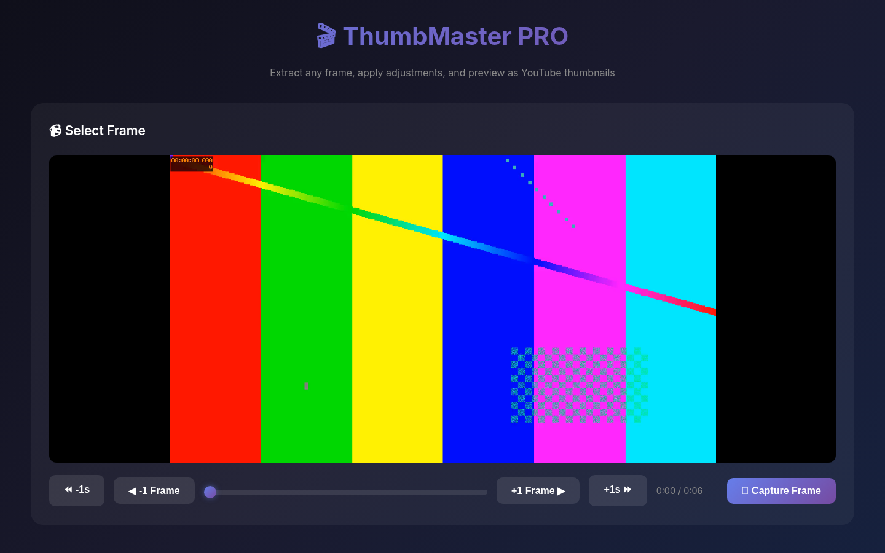

# ThumbMaster PRO


A client-side web app for pulling a frame out of a video and turning it into a YouTube-style thumbnail. Everything runs in the browser, so videos are never uploaded anywhere.



*Frame selector with a generated test-pattern video (no real footage).*

## Features

- **Frame extraction:** scrub through a video, step by frame or by one second, and capture the shot you want
- **Adjustments:** brightness, contrast, saturation and warmth
- **Quality controls:** JPEG quality, sharpness, chroma fidelity and noise reduction
- **Live preview:** see how the thumbnail looks in YouTube-style contexts before exporting

## Tech stack

Plain HTML, CSS and JavaScript in a single `index.html`. Canvas API for frame capture and image processing. Inter font from Google Fonts. No build step and no dependencies.

## Requirements

A modern browser with HTML5 video and canvas support, and a video file your browser can play (MP4/H.264 works in most browsers).

## Run locally

```bash
git clone https://github.com/Aboodseada1/thumbmaster-pro.git
cd thumbmaster-pro
python3 -m http.server 8000     # or any static server
```

Open http://localhost:8000.

## Usage

1. Choose a video file.
2. Move the slider or use the -1s, -1 Frame, +1 Frame and +1s buttons to find your frame.
3. Click **Capture Frame**.
4. Adjust the image settings and check the preview.
5. Export the thumbnail.

## Configuration

None. There are no environment variables, API keys or backend.

## Tests

There is no automated test suite. The tool was checked manually in the browser.
